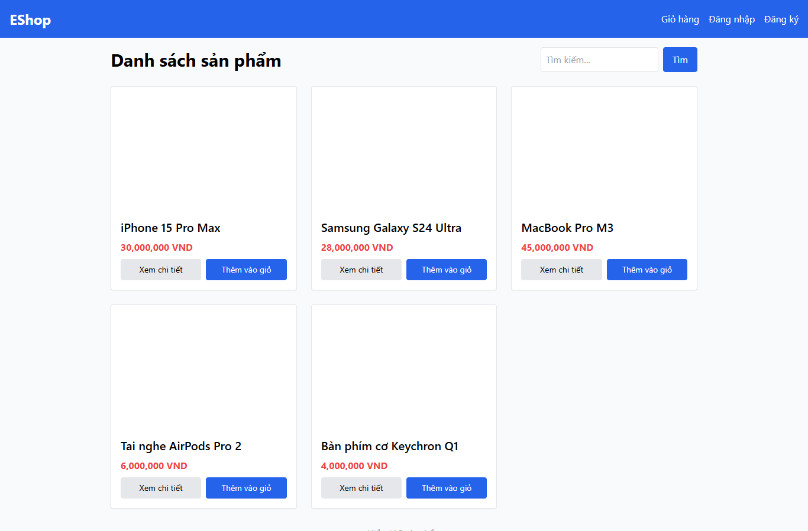

# IA01-001 - [IA-01] Trang chủ có hai tiêu đề h1 khi catalog đã tải

GitHub Issue: https://github.com/henry-banana/software-testing-hw03-gui-usability-testing/issues/1

## Summary

Trang chủ có hai tiêu đề h1 khi catalog đã tải.

- Finding: IA01-001.
- Checklist: GUI-001.
- Requirement: FR-21; FR-05.
- Severity: Low.

## Environment

- EShop baseline: 85af3ba875c88283615e22cb108f13e2fccaf0e9.
- Google Chrome 157.0.8103.38, Windows 10.0.26300.
- Firefox (Playwright build) 159.0, Windows 10.0.26300.
- Viewport: 1366 x 900.
- SUT: http://localhost:5173/

## Preconditions

Khách, browser context mới. Trang chủ đã tải 5 sản phẩm seed.

## Steps to reproduce

1. Đếm h1 sau khi catalog tải xong.

## Expected result

Đúng một h1 mô tả danh sách sản phẩm.

## Actual result

~~~text
[
  "Danh sách sản phẩm",
  "Hiển thị 5 sản phẩm"
]
~~~

## Impact

Công nghệ hỗ trợ nhận thêm một tiêu đề cấp một dùng cho bộ đếm, làm sai cấu trúc điều hướng theo heading.

## Reproducibility

Tái hiện ở Chrome và Firefox trong các lượt C1 có context riêng. Kết quả được ghi theo ID trên từng nền tảng.

## Evidence

