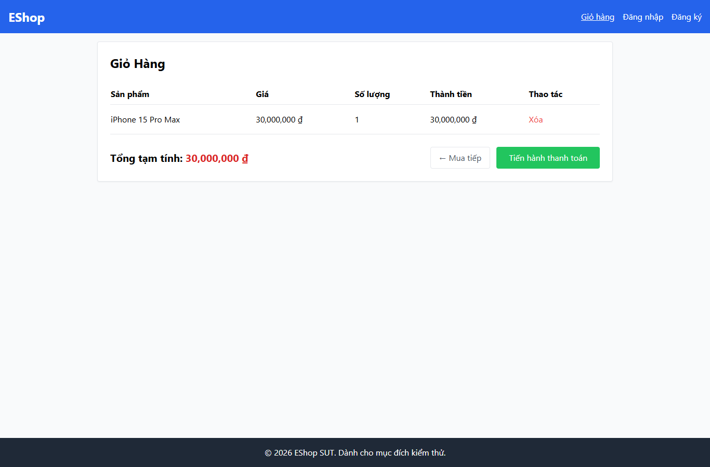

# IA01-002 - [IA-01] Giỏ hàng có sản phẩm nhưng thiếu tiêu đề h1

GitHub Issue: https://github.com/henry-banana/software-testing-hw03-gui-usability-testing/issues/2

## Summary

Giỏ hàng có sản phẩm nhưng thiếu tiêu đề h1.

- Finding: IA01-002.
- Checklist: GUI-003.
- Requirement: FR-21.
- Severity: Low.

## Environment

- EShop baseline: 85af3ba875c88283615e22cb108f13e2fccaf0e9.
- Google Chrome 157.0.8103.38, Windows 10.0.26300.
- Firefox (Playwright build) 159.0, Windows 10.0.26300.
- Viewport: 1366 x 900.
- SUT: http://localhost:5173/cart

## Preconditions

Khách. Thêm một iPhone từ Trang chủ rồi mở Giỏ hàng.

## Steps to reproduce

1. Đếm h1 trong giỏ có một dòng.

## Expected result

Đúng một h1 mô tả giỏ hàng.

## Actual result

~~~text
[]
~~~

## Impact

Người dùng điều hướng theo heading không có tiêu đề cấp một để nhận diện Giỏ hàng.

## Reproducibility

Tái hiện ở Chrome và Firefox trong các lượt C1 có context riêng. Kết quả được ghi theo ID trên từng nền tảng.

## Evidence

