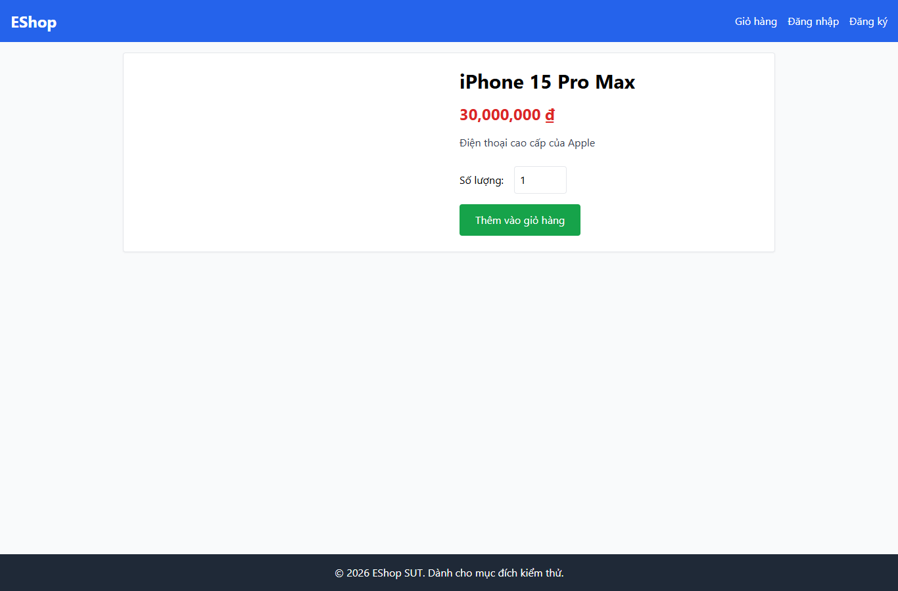

# IA01-004 - [IA-01] Chi tiết sản phẩm dùng màu xanh lá cho nút Thêm vào giỏ hàng

GitHub Issue: https://github.com/henry-banana/software-testing-hw03-gui-usability-testing/issues/4

## Summary

Chi tiết sản phẩm dùng màu xanh lá cho nút Thêm vào giỏ hàng.

- Finding: IA01-004.
- Checklist: GUI-010.
- Requirement: FR-21.
- Severity: Low.

## Environment

- EShop baseline: 85af3ba875c88283615e22cb108f13e2fccaf0e9.
- Google Chrome 157.0.8103.38, Windows 10.0.26300.
- Firefox (Playwright build) 159.0, Windows 10.0.26300.
- Viewport: 1366 x 900.
- SUT: http://localhost:5173/product/1

## Preconditions

Khách. Từ Trang chủ mở iPhone 15 Pro Max, giá seed 30.000.000 đồng.

## Steps to reproduce

1. Đọc màu nền nút Thêm vào giỏ hàng.

## Expected result

Nút mua hàng có màu xanh dương.

## Actual result

~~~text
rgb(22, 163, 74)
~~~

## Impact

Màu nút mua hàng không đồng nhất với màu xanh dương quy định cho hành động chính.

## Reproducibility

Tái hiện ở Chrome và Firefox trong các lượt C1 có context riêng. Kết quả được ghi theo ID trên từng nền tảng.

## Evidence

