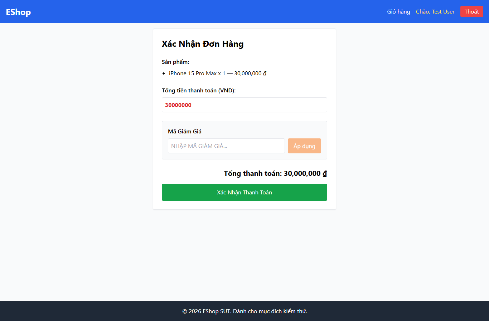

# IA01-005 - [IA-01] Checkout dùng màu xanh lá cho nút Xác Nhận Thanh Toán

GitHub Issue: https://github.com/henry-banana/software-testing-hw03-gui-usability-testing/issues/5

## Summary

Checkout dùng màu xanh lá cho nút Xác Nhận Thanh Toán.

- Finding: IA01-005.
- Checklist: GUI-012.
- Requirement: FR-21.
- Severity: Low.

## Environment

- EShop baseline: 85af3ba875c88283615e22cb108f13e2fccaf0e9.
- Google Chrome 157.0.8103.38, Windows 10.0.26300.
- Firefox (Playwright build) 159.0, Windows 10.0.26300.
- Viewport: 1366 x 900.
- SUT: http://localhost:5173/checkout

## Preconditions

Đăng nhập bằng tài khoản demo. Thêm một iPhone từ Trang chủ, vào Giỏ hàng rồi bấm Tiến hành thanh toán.

## Steps to reproduce

1. Đọc màu nền nút xác nhận thanh toán.

## Expected result

Nút mua hàng có màu xanh dương.

## Actual result

~~~text
rgb(22, 163, 74)
~~~

## Impact

Nút chính ở bước xác nhận đơn dùng màu khác tiêu chuẩn giao diện, làm giảm nhất quán giữa các màn.

## Reproducibility

Tái hiện ở Chrome và Firefox trong các lượt C1 có context riêng. Kết quả được ghi theo ID trên từng nền tảng.

## Evidence

