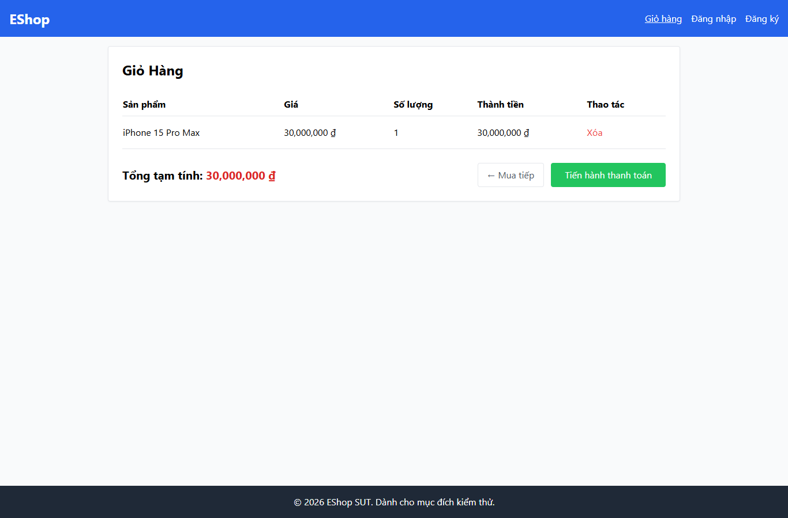

# IA02-003 - [IA-02] Chi tiết sản phẩm nhận số lượng 1.5 rồi tự đổi thành 1 trong giỏ

GitHub Issue: https://github.com/henry-banana/software-testing-hw03-gui-usability-testing/issues/9

## Summary

Chi tiết sản phẩm nhận số lượng 1.5 rồi tự đổi thành 1 trong giỏ.

- Finding: IA02-003.
- Checklist: GUI-019.
- Requirement: FR-06.
- Severity: Medium.

## Environment

- EShop baseline: 85af3ba875c88283615e22cb108f13e2fccaf0e9.
- Google Chrome 157.0.8103.38, Windows 10.0.26300.
- Firefox (Playwright build) 159.0, Windows 10.0.26300.
- Viewport: 1366 x 900.
- SUT: http://localhost:5173/cart

## Preconditions

Khách. Từ Trang chủ mở iPhone 15 Pro Max, giá seed 30.000.000 đồng.

## Steps to reproduce

1. Nhập số thập phân.
2. Bấm Thêm vào giỏ tối đa hai lần vì lượt đầu có thể bị bỏ qua.
3. Kiểm tra giỏ.

## Expected result

Sản phẩm không được thêm với số thập phân.

## Actual result

~~~text
{
  "value": "1.5",
  "feedback": "Đã thêm",
  "rows": [
    "iPhone 15 Pro Max30,000,000 ₫130,000,000 ₫Xóa"
  ]
}
~~~

## Impact

Giỏ lưu số lượng khác dữ liệu người dùng vừa nhập mà không báo sai định dạng.

## Reproducibility

Tái hiện ở Chrome và Firefox trong các lượt C1 có context riêng. Kết quả được ghi theo ID trên từng nền tảng.

## Evidence

