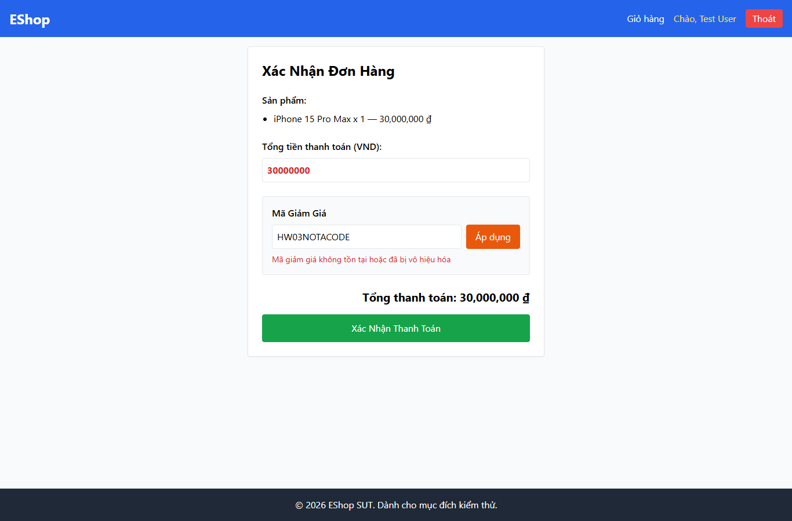

# IA02-005 - [IA-02] Checkout đặt lỗi mã không tồn tại bên dưới nút Áp dụng

GitHub Issue: https://github.com/henry-banana/software-testing-hw03-gui-usability-testing/issues/11

## Summary

Checkout đặt lỗi mã không tồn tại bên dưới nút Áp dụng.

- Finding: IA02-005.
- Checklist: GUI-022.
- Requirement: FR-22.
- Severity: Low.

## Environment

- EShop baseline: 85af3ba875c88283615e22cb108f13e2fccaf0e9.
- Google Chrome 157.0.8103.38, Windows 10.0.26300.
- Firefox (Playwright build) 159.0, Windows 10.0.26300.
- Viewport: 1366 x 900.
- SUT: http://localhost:5173/checkout

## Preconditions

Đăng nhập bằng tài khoản demo. Thêm một iPhone từ Trang chủ, vào Giỏ hàng rồi bấm Tiến hành thanh toán.

## Steps to reproduce

1. Áp dụng mã không tồn tại.
2. So sánh vị trí thông báo với nút Áp dụng.

## Expected result

Lỗi của ô mã được đặt phía trên nút Áp dụng.

## Actual result

~~~text
{
  "text": [
    "Mã giảm giá không tồn tại hoặc đã bị vô hiệu hóa"
  ],
  "errorY": 438,
  "buttonY": 388
}
~~~

## Impact

Vị trí phản hồi lỗi khác quy tắc bố trí biểu mẫu FR-22.

## Reproducibility

Tái hiện ở Chrome và Firefox trong các lượt C1 có context riêng. Kết quả được ghi theo ID trên từng nền tảng.

## Evidence

