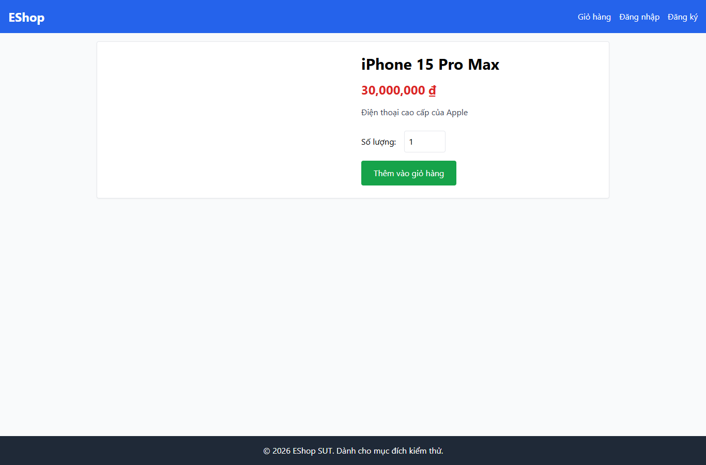

# IA02-006 - [IA-02] Ô số lượng ở Chi tiết sản phẩm thiếu tên truy cập

GitHub Issue: https://github.com/henry-banana/software-testing-hw03-gui-usability-testing/issues/12

## Summary

Ô số lượng ở Chi tiết sản phẩm thiếu tên truy cập.

- Finding: IA02-006.
- Checklist: GUI-026.
- Requirement: FR-22 và [WCAG 2.2 SC 4.1.2](https://www.w3.org/WAI/WCAG22/Understanding/name-role-value.html) (tiêu chí bổ sung).
- Severity: Medium.

## Environment

- EShop baseline: 85af3ba875c88283615e22cb108f13e2fccaf0e9.
- Google Chrome 157.0.8103.38, Windows 10.0.26300.
- Firefox (Playwright build) 159.0, Windows 10.0.26300.
- Viewport: 1366 x 900.
- SUT: http://localhost:5173/product/1

## Preconditions

Khách. Từ Trang chủ mở iPhone 15 Pro Max, giá seed 30.000.000 đồng.

## Steps to reproduce

1. Đối chiếu tên nhãn số lượng được công bố cho điều khiển.

## Expected result

Tên số lượng được liên kết với ô nhập.

## Actual result

~~~text
- spinbutton: "1"
~~~

## Impact

Công nghệ hỗ trợ nhận vai trò spinbutton và giá trị nhưng không có tên để phân biệt trường.

## Reproducibility

Tái hiện ở Chrome và Firefox trong các lượt C1 có context riêng. Kết quả được ghi theo ID trên từng nền tảng.

## Evidence

