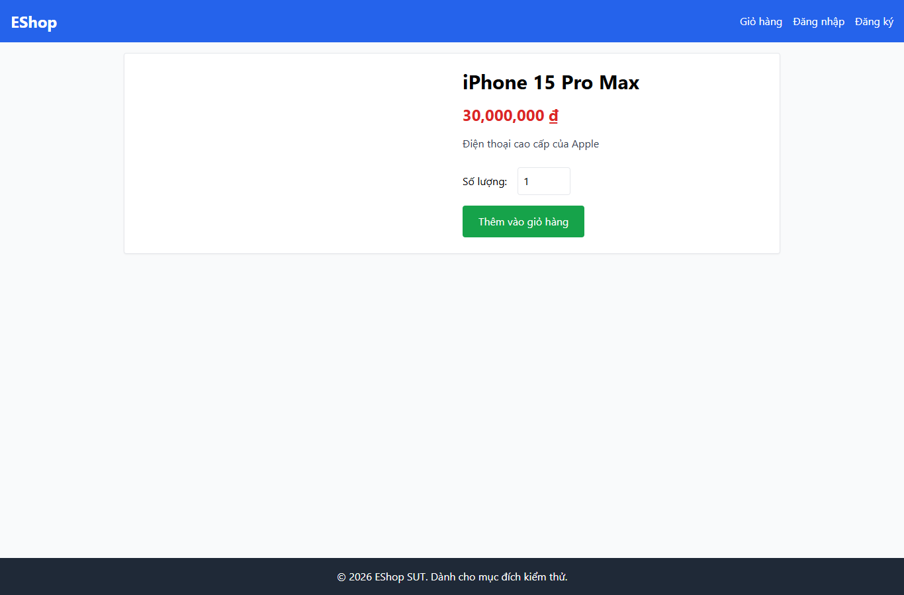

# IA03-001 - [IA-03] Chi tiết sản phẩm không có breadcrumb khi mở sản phẩm seed

GitHub Issue: https://github.com/henry-banana/software-testing-hw03-gui-usability-testing/issues/13

## Summary

Chi tiết sản phẩm không có breadcrumb khi mở sản phẩm seed.

- Finding: IA03-001.
- Checklist: GUI-033.
- Requirement: FR-23.
- Severity: Low.

## Environment

- EShop baseline: 85af3ba875c88283615e22cb108f13e2fccaf0e9.
- Google Chrome 157.0.8103.38, Windows 10.0.26300.
- Firefox (Playwright build) 159.0, Windows 10.0.26300.
- Viewport: 1366 x 900.
- SUT: http://localhost:5173/product/1

## Preconditions

Khách. Từ Trang chủ mở iPhone 15 Pro Max, giá seed 30.000.000 đồng.

## Steps to reproduce

1. Tìm đường dẫn phân cấp trong nội dung Chi tiết.

## Expected result

Có breadcrumb thể hiện đường dẫn từ Trang chủ.

## Actual result

~~~text
{
  "navigation": []
}
~~~

## Impact

Trang chi tiết không có đường dẫn phân cấp theo FR-23. Issue cũ về breadcrumb Giỏ hàng có đường dẫn khác.

## Reproducibility

Tái hiện ở Chrome và Firefox trong các lượt C1 có context riêng. Kết quả được ghi theo ID trên từng nền tảng.

## Evidence

