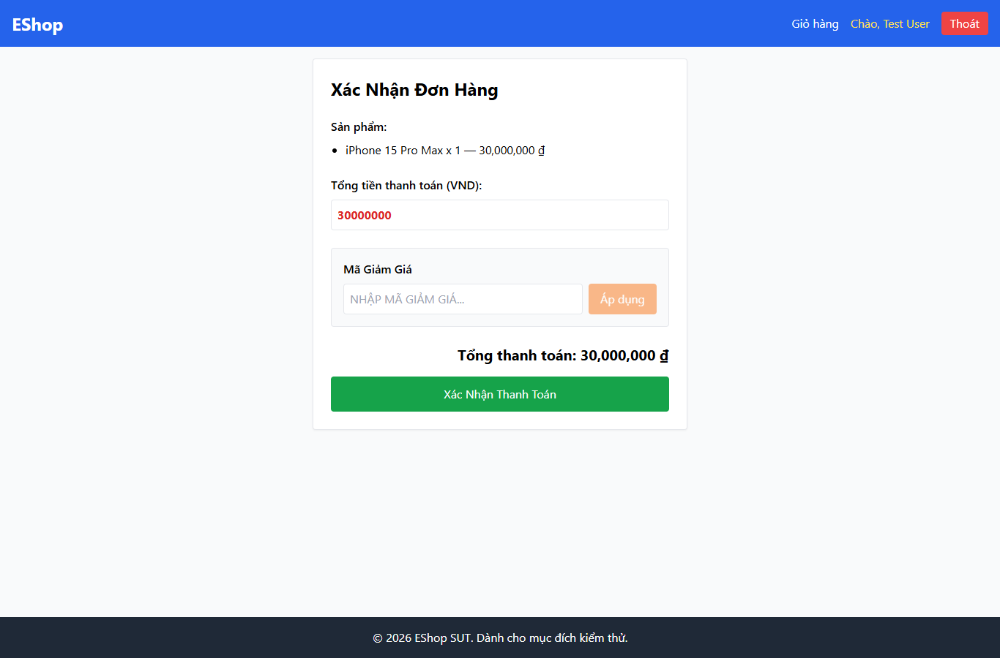

# IA03-002 - [IA-03] Checkout không có breadcrumb khi giỏ đã có sản phẩm

GitHub Issue: https://github.com/henry-banana/software-testing-hw03-gui-usability-testing/issues/14

## Summary

Checkout không có breadcrumb khi giỏ đã có sản phẩm.

- Finding: IA03-002.
- Checklist: GUI-035.
- Requirement: FR-23.
- Severity: Low.

## Environment

- EShop baseline: 85af3ba875c88283615e22cb108f13e2fccaf0e9.
- Google Chrome 157.0.8103.38, Windows 10.0.26300.
- Firefox (Playwright build) 159.0, Windows 10.0.26300.
- Viewport: 1366 x 900.
- SUT: http://localhost:5173/checkout

## Preconditions

Đăng nhập bằng tài khoản demo. Thêm một iPhone từ Trang chủ, vào Giỏ hàng rồi bấm Tiến hành thanh toán.

## Steps to reproduce

1. Tìm đường dẫn phân cấp trong Checkout có sản phẩm.

## Expected result

Có breadcrumb thể hiện đường dẫn từ Trang chủ.

## Actual result

~~~text
{
  "navigation": []
}
~~~

## Impact

Người dùng ở bước xác nhận đơn thiếu đường dẫn phân cấp để định vị trong luồng.

## Reproducibility

Tái hiện ở Chrome và Firefox trong các lượt C1 có context riêng. Kết quả được ghi theo ID trên từng nền tảng.

## Evidence

