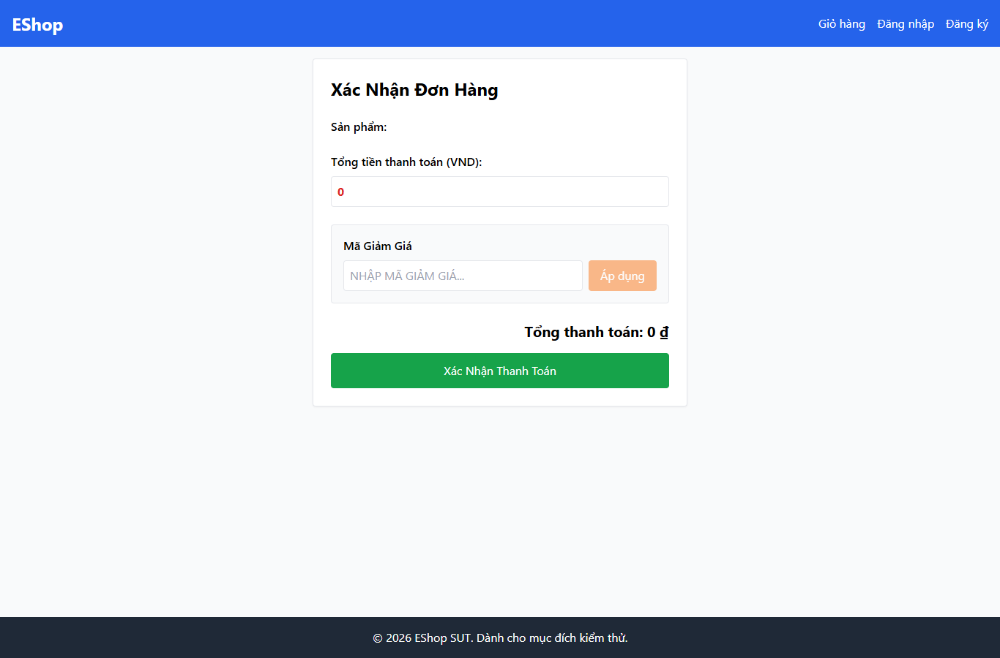

# IA03-003 - [IA-03] Khách truy cập trực tiếp Checkout và thấy nút xác nhận

GitHub Issue: https://github.com/henry-banana/software-testing-hw03-gui-usability-testing/issues/15

## Summary

Khách truy cập trực tiếp Checkout và thấy nút xác nhận.

- Finding: IA03-003.
- Checklist: GUI-039.
- Requirement: FR-08.
- Severity: Medium.

## Environment

- EShop baseline: 85af3ba875c88283615e22cb108f13e2fccaf0e9.
- Google Chrome 157.0.8103.38, Windows 10.0.26300.
- Firefox (Playwright build) 159.0, Windows 10.0.26300.
- Viewport: 1366 x 900.
- SUT: http://localhost:5173/checkout

## Preconditions

Browser context mới, khách chưa đăng nhập. Mở trực tiếp đường dẫn /checkout.

## Steps to reproduce

1. Mở trực tiếp /checkout khi chưa đăng nhập.

## Expected result

Khách không truy cập được form xác nhận thanh toán đang hoạt động.

## Actual result

~~~text
{
  "url": "http://localhost:5173/checkout",
  "payVisible": true
}
~~~

## Impact

Khách có thể đến màn xác nhận qua URL và thấy nút thanh toán trước khi đăng nhập. Phát hiện này giới hạn ở điều hướng giao diện.

## Reproducibility

Tái hiện ở Chrome và Firefox trong các lượt C1 có context riêng. Kết quả được ghi theo ID trên từng nền tảng.

## Evidence

