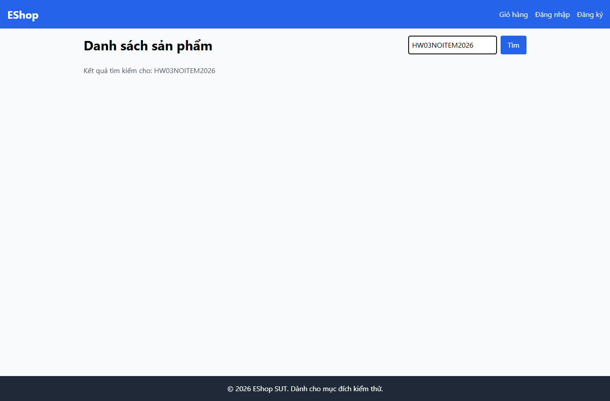

# IA04-001 - [IA-04] Trang chủ không báo không có kết quả khi tìm chuỗi không khớp

GitHub Issue: https://github.com/henry-banana/software-testing-hw03-gui-usability-testing/issues/16

## Summary

Trang chủ không báo không có kết quả khi tìm chuỗi không khớp.

- Finding: IA04-001.
- Checklist: GUI-042.
- Requirement: FR-05.
- Severity: Medium.

## Environment

- EShop baseline: 85af3ba875c88283615e22cb108f13e2fccaf0e9.
- Google Chrome 157.0.8103.38, Windows 10.0.26300.
- Firefox (Playwright build) 159.0, Windows 10.0.26300.
- Viewport: 1366 x 900.
- SUT: http://localhost:5173/

## Preconditions

Khách, browser context mới. Trang chủ đã tải 5 sản phẩm seed.

## Steps to reproduce

1. Tìm chuỗi HW03NOITEM2026 và chờ API trả 0 kết quả.

## Expected result

Trang hiện thông báo không có kết quả.

## Actual result

~~~text
Danh sách sản phẩm
Tìm
Kết quả tìm kiếm cho: HW03NOITEM2026
~~~

## Impact

Người dùng thấy vùng kết quả trống và thiếu thông báo để biết nên đổi từ khóa.

## Reproducibility

Tái hiện ở Chrome và Firefox trong các lượt C1 có context riêng. Kết quả được ghi theo ID trên từng nền tảng.

## Evidence

