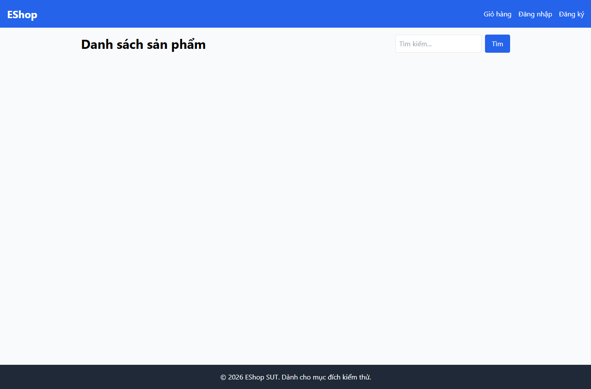

# IA04-002 - [IA-04] Trang chủ thiếu trạng thái tải khi request catalog đang chờ

GitHub Issue: https://github.com/henry-banana/software-testing-hw03-gui-usability-testing/issues/17

## Summary

Trang chủ thiếu trạng thái tải khi request catalog đang chờ.

- Finding: IA04-002.
- Checklist: GUI-043.
- Requirement: FR-05.
- Severity: Low.

## Environment

- EShop baseline: 85af3ba875c88283615e22cb108f13e2fccaf0e9.
- Google Chrome 157.0.8103.38, Windows 10.0.26300.
- Firefox (Playwright build) 159.0, Windows 10.0.26300.
- Viewport: 1366 x 900.
- SUT: http://localhost:5173/

## Preconditions

Browser context mới. Chưa mở trang.

## Steps to reproduce

1. Giữ request catalog ở trạng thái đang chờ rồi đọc UI.

## Expected result

Trang chủ có phản hồi đang tải trước khi sản phẩm xuất hiện.

## Actual result

~~~text
Danh sách sản phẩm
Tìm
~~~

## Impact

Trong khi request thật chưa trả về, vùng catalog trống và người dùng thiếu tín hiệu cho biết trang vẫn đang tải.

## Reproducibility

Tái hiện ở Chrome và Firefox trong các lượt C1 có context riêng. Lượt kiểm giữ request catalog thật ở trạng thái chờ để quan sát giao diện.

## Evidence

