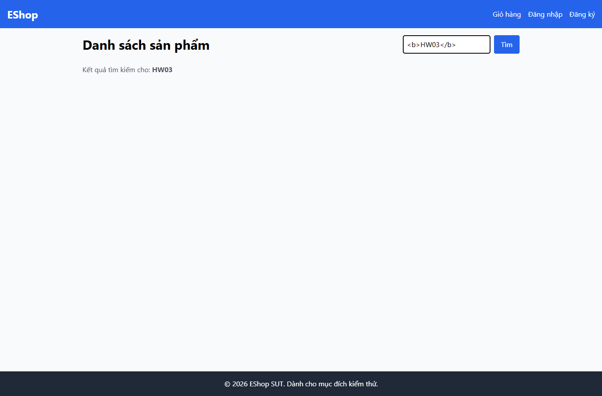

# IA04-003 - [IA-04] Trang chủ render thẻ HTML trong vùng hiển thị từ khóa tìm kiếm

GitHub Issue: https://github.com/henry-banana/software-testing-hw03-gui-usability-testing/issues/18

## Summary

Trang chủ render thẻ HTML trong vùng hiển thị từ khóa tìm kiếm.

- Finding: IA04-003.
- Checklist: GUI-045.
- Requirement: FR-05.
- Severity: Medium.

## Environment

- EShop baseline: 85af3ba875c88283615e22cb108f13e2fccaf0e9.
- Google Chrome 157.0.8103.38, Windows 10.0.26300.
- Firefox (Playwright build) 159.0, Windows 10.0.26300.
- Viewport: 1366 x 900.
- SUT: http://localhost:5173/

## Preconditions

Khách, browser context mới. Trang chủ đã tải 5 sản phẩm seed.

## Steps to reproduce

1. Nhập và tìm chuỗi thử vô hại <b>HW03</b>.
2. Kiểm tra vùng hiển thị từ khóa.

## Expected result

Chuỗi được hiển thị như văn bản, không tạo thẻ HTML từ đầu vào.

## Actual result

~~~text
{
  "rendered": [
    "HW03"
  ],
  "body": "Danh sách sản phẩm\nTìm\nKết quả tìm kiếm cho: HW03"
}
~~~

## Impact

Dữ liệu nhập thay đổi cấu trúc hiển thị của trang, trái yêu cầu hiển thị an toàn. Chỉ kiểm với markup b vô hại.

## Reproducibility

Tái hiện ở Chrome và Firefox trong các lượt C1 có context riêng. Kết quả được ghi theo ID trên từng nền tảng.

## Evidence

