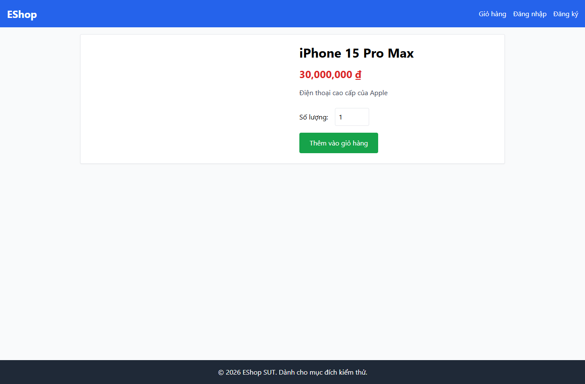

# IA04-004 - [IA-04] Chi tiết iPhone 15 Pro Max không hiển thị danh mục sản phẩm

GitHub Issue: https://github.com/henry-banana/software-testing-hw03-gui-usability-testing/issues/19

## Summary

Chi tiết iPhone 15 Pro Max không hiển thị danh mục sản phẩm.

- Finding: IA04-004.
- Checklist: GUI-047.
- Requirement: FR-06.
- Severity: Low.

## Environment

- EShop baseline: 85af3ba875c88283615e22cb108f13e2fccaf0e9.
- Google Chrome 157.0.8103.38, Windows 10.0.26300.
- Firefox (Playwright build) 159.0, Windows 10.0.26300.
- Viewport: 1366 x 900.
- SUT: http://localhost:5173/product/1

## Preconditions

Khách. Từ Trang chủ mở iPhone 15 Pro Max, giá seed 30.000.000 đồng.

## Steps to reproduce

1. Tìm danh mục của sản phẩm iPhone trên trang chi tiết.

## Expected result

Trang hiển thị danh mục Điện thoại của sản phẩm.

## Actual result

~~~text
[]
~~~

## Impact

Người mua không thấy danh mục Điện thoại ở trang chi tiết dù đây là thông tin bắt buộc theo FR-06.

## Reproducibility

Tái hiện ở Chrome và Firefox trong các lượt C1 có context riêng. Kết quả được ghi theo ID trên từng nền tảng.

## Evidence

